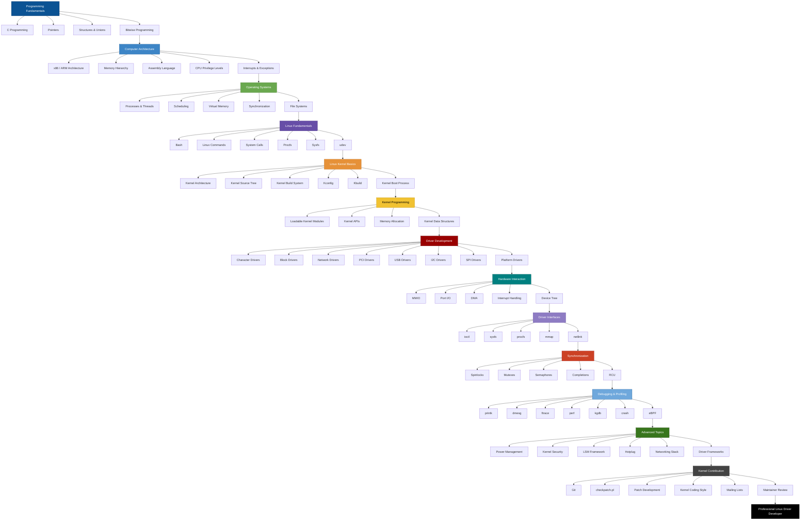

    

        
    

# `Awesome` [Linux](https://wikipedia.org/wiki/Linux_kernel_interfaces) [Driver](https://wikipedia.org/wiki/Driver_(software)) [Development](https://wikipedia.org/wiki/Device_driver) 

    
    &nbsp;
    
    &nbsp;
    

## 📖 Contents
- [My Other Awesome Lists](#my-other-awesome-lists)
- [Contributing](#contributing)
- [Contributors](#contributors)

In Linux, drivers are categorized based on the type of device or functionality they manage. 
* The device driver types are:
    * [Character Device](https://linux-kernel-labs.github.io/refs/heads/master/labs/device_drivers.html)
    * [Block Device](https://linux-kernel-labs.github.io/refs/heads/master/labs/block_device_drivers.html)
    * [Network Device](https://linux-kernel-labs.github.io/refs/heads/master/labs/networking.html)
* Other Drivers
    * File System Drivers
    * Virtual Drivers
    * Platform Drivers
    * Pseudo Drivers
    * User-Space Drivers

## 1. [Kernel](https://linux-kernel-labs.github.io/refs/heads/master/)-Space Driver

### 1.1 Device [Driver](https://www.kernel.org/doc/html/v6.16/driver-api/index.html)

#### Programming Guide
- [Tutorial for Linux Driver Development](https://www.apriorit.com/dev-blog/195-simple-driver-for-linux-os)

### 1.2 [Kernel](https://docs.redhat.com/en/documentation/red_hat_enterprise_linux/7/html/kernel_administration_guide) [Module](https://en.wikipedia.org/wiki/Loadable_kernel_module)

#### Programming Guide
 - [Linux Kernel Module](https://github.com/sysprog21/lkmpg) - The Linux Kernel Module [Programming](https://sysprog21.github.io/lkmpg) Guide

## 2. [User-Space](https://en.wikipedia.org/wiki/User_space_and_kernel_space) Driver

## 3. Miscellaneous
- [https://lxr.linux.no/](https://lxr.linux.no/) - Linux source code repositories.
- [https://elixir.bootlin.com/](https://elixir.bootlin.com/linux) - Linux source code repositories.
- [https://kernelnewbies.org/](https://kernelnewbies.org/)
- [https://www.kernel.org/doc/html/latest/](https://www.kernel.org/doc/html/latest/)
- [https://lwn.net/](https://lwn.net/)
- [https://embetronicx.com/](https://embetronicx.com/)

##
### My Other Awesome Lists
You can access the my other awesome lists [here](https://cyberthreatdefence.com/my_awesome_lists)

### Contributing
[Contributions of any kind welcome, just follow the guidelines](contributing.md)!

### Contributors
[Thanks goes to these contributors](https://github.com/cybersecurity-dev/awesome-linux-driver-development/graphs/contributors)!

### License

[🔼 Back to top](#awesome-linux-driver-development-)
